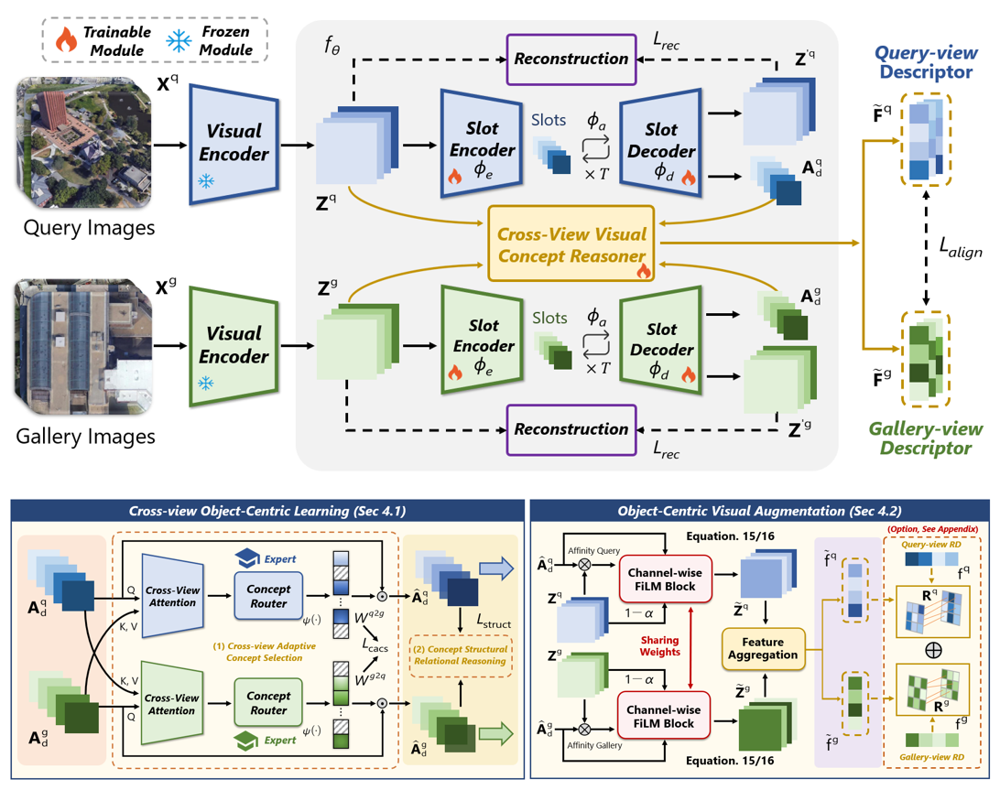

<h3 align="center">InfoGeo: Information-Theoretic Object-Centric Learning<br>for Cross-View Generalizable UAV Geo-Localization</h3>

<p align="center">
  <a href="https://github.com/HRT00/Official_InfoGeo"></a>
  <a href="https://opensource.org/license/mit"></a>
  <a href="https://arxiv.org/abs/2605.07099"></a>
  <a href="https://drive.google.com/drive/folders/14cTbTPOniN_VlJrifTMdjWJ3foGgqIuq"></a>
</p>

<p align="center">
  By <a href="https://hrt00.github.io/hyzhang.github.io/" target="_blank">Hongyang Zhang<sup>1,*</sup></a>,&nbsp;
  Maonan Wang<sup>2,3,*</sup>,&nbsp;
  Ziyao Wang<sup>1</sup>,&nbsp;
  Hongrui Yin<sup>1,2</sup>,&nbsp;
  Man On Pun<sup>1,†</sup>
</p>

<p align="center">
  <sup>1</sup>CUHK-Shenzhen; 
  <sup>2</sup>CUHK; 
  <sup>3</sup>Shanghai AI Lab
</p>

<p align="center">
  <sup>*</sup>Equal contribution. <sup>†</sup>Corresponding author.
</p>

<p align="center">
  <a href="#overview">Overview</a> ·
  <a href="#how-to-use">Getting Started</a> ·
  <a href="#training">Training</a> ·
  <a href="#evaluation">Evaluation</a> ·
  <a href="#rerun-11-26">Reproduction Logs</a> ·
  <a href="#citation">Citation</a>
</p>

## <a id="news"></a> 🔥 News

- 🚀 **July 30, 2026:** The InfoGeo model and evaluation code are now open source.
- 🚩 **June 13, 2026:** The InfoGeo model checkpoints have been released.
- 😃 **May 26, 2026:** InfoGeo was featured on [WeChat](https://mp.weixin.qq.com/s/S_7yeJJbXJIqsDUSS8Mf-w) (公众号：**Visual-Language Navigation / 视觉语言导航**).
- 🚩 **May 08, 2026:** Our [preprint](https://arxiv.org/pdf/2605.07099) is now available.
- 🎉 **May 01, 2026:** InfoGeo has been accepted to ICML'26. See you in Seoul, South Korea!

<a id="overview"></a>
## 📝 Overview

<div align="center">
  
  <br>
  <em>Overview of the InfoGeo framework.</em>
</div>

Cross-view geo-localization (CVGL) matches ground or UAV imagery with satellite views to support localization and navigation in GPS-denied environments. Changes in regional appearance and weather create domain shifts that challenge global feature alignment. UAV imagery adds another difficulty: its broad field of view captures dense, fine-grained objects that introduce visual clutter.

**InfoGeo** draws on Object-Centric Learning (OCL) to improve robustness and generalization. It formulates learning as an information bottleneck with two objectives:

- **Preserve view-invariant information** by aligning object-centric structural relations across views.
- **Suppress view-specific noise** through cross-view knowledge constraints.

<a id="how-to-use"></a>
## 🚀 How to Use

### (1) Environment

Clone the repository and create a Python 3.10 environment. Run the following commands from the repository root after cloning.

```bash
git clone https://github.com/HRT00/Official_InfoGeo.git
cd Official_InfoGeo
conda create -n cvgl python=3.10 -y
conda activate cvgl
python -m pip install --upgrade pip
pip install -r requirements.txt
unzip -q dinov2-main.zip -d vendor
```

The requirements pin PyTorch 2.0.1 with CUDA 11.8. Training uses a single CUDA GPU, selected through `CUDA_VISIBLE_DEVICES`.

### (2) Datasets

Prepare the images following the instructions from each dataset repository.

| Dataset | Resource |
| --- | --- |
| University-1652 | [Dataset and baseline](https://github.com/layumi/University1652-Baseline) |
| SUES-200 | [Dataset and benchmark](https://github.com/Reza-Zhu/SUES-200-Benchmark) |
| DenseUAV | [Dataset repository](https://github.com/Dmmm1997/DenseUAV) |
| GTA-UAV (GTA-V) | [Dataset repository](https://github.com/Yux1angJi/GTA-UAV) |

Set `DATA_ROOT` to the parent directory of the datasets. The default is `data/` under the repository root.

```bash
export DATA_ROOT=/path/to/datasets
```

<details>
<summary>Expected dataset layout</summary>

```text
$DATA_ROOT/
├── DenseUAV/
│   └── train/
│       ├── drone/<location_id>/H80.JPG
│       └── satellite/<location_id>/...
├── University-1652/
│   └── train/
│       ├── drone/<location_id>/image-41.jpeg ... image-49.jpeg
│       └── satellite/<location_id>/...
├── SUES-200/
│   └── SUES-200-512x512/Testing/150/
│       ├── query_drone/<location_id>/...
│       └── gallery_satellite/<location_id>/...
└── GTA-UAV/
    ├── cross-area-drone2sate-train.json
    ├── cross-area-drone2sate-test.json
    ├── satellite/...
    └── ... image paths referenced by the metadata
```

</details>

For experiments with weather variations, prepare the query images using WeatherPrompt and its weather generation script. [WeatherPrompt](https://github.com/Jahawn-Wen/WeatherPrompt) · [Generation script](https://github.com/Jahawn-Wen/WeatherPrompt/blob/main/weather.py)

### (3) Model Checkpoints

| Component | Download |
| --- | --- |
| DINOv2-base backbone | [DINOv2 repository](https://github.com/facebookresearch/dinov2) |
| InfoGeo model checkpoints | [Google Drive](https://drive.google.com/drive/folders/14cTbTPOniN_VlJrifTMdjWJ3foGgqIuq) |

For training, place the pretrained DINOv2-base weights at `checkpoints/dinov2_vitb14_pretrain.pth`, or specify their location through `DINOV2_WEIGHTS`.

```bash
export DINOV2_WEIGHTS=/path/to/dinov2_vitb14_pretrain.pth
```

Evaluation loads the full InfoGeo checkpoint supplied with `--checkpoint`.

<a id="training"></a>
### (4) Training

All experiments use `train_reference.py` for training. Each bash script provides the configuration for its training dataset and evaluation protocol. After preparing the datasets and pretrained backbone, run the corresponding command below.

```bash
# DenseUAV to SUES-200 at 150 m
CUDA_VISIBLE_DEVICES=0 bash scripts/dense_to_sues150.sh train

# University-1652 to SUES-200 at 150 m
CUDA_VISIBLE_DEVICES=0 bash scripts/university_to_sues150.sh train

# GTA-UAV cross-area retrieval
CUDA_VISIBLE_DEVICES=0 bash scripts/gta_cross_area.sh train
```

<a id="evaluation"></a>
### (5) Evaluation

Use the matching launcher in `eval` mode to run `eval_cvgl_slot.py`. Pass the full checkpoint path from a completed run or a downloaded InfoGeo checkpoint. [Evaluation script](eval_cvgl_slot.py)

```bash
# DenseUAV-trained checkpoint → SUES-200 at 150 m
CUDA_VISIBLE_DEVICES=0 bash scripts/dense_to_sues150.sh eval \
  --checkpoint /path/to/dense_checkpoint.pth

# University-trained checkpoint → SUES-200 at 150 m
CUDA_VISIBLE_DEVICES=0 bash scripts/university_to_sues150.sh eval \
  --checkpoint /path/to/university_checkpoint.pth

# GTA-UAV cross-area checkpoint → GTA-UAV cross-area test split
CUDA_VISIBLE_DEVICES=0 bash scripts/gta_cross_area.sh eval \
  --checkpoint /path/to/gta_checkpoint.pth
```

Both SUES-200 launchers use `Testing/150` with **4,000 drone queries and 200 satellite gallery images**. For comparison with the recorded results below, use the indicated checkpoint epoch and evaluation batch size of 128.

<a id="rerun-11-26"></a>
### (6) Reproduction Logs · `rerun_11_26`

We include the training logs and separate checkpoint evaluation records from **`rerun_11_26`** in `results/`. These records cover DenseUAV and University-1652 transfer to SUES-200 at 150 m. [Result logs](results/)

| Training dataset | Checkpoint epoch | R@1 (%) | AP (%) | Training log | Evaluation log |
| --- | ---: | ---: | ---: | --- | --- |
| DenseUAV | 1 | 89.8500 | 91.6127 | [train.log](results/dense_to_sues150/train.log) | [eval.log](results/dense_to_sues150/eval.log) |
| University-1652 | 28 | 92.7250 | 93.9302 | [train.log](results/university_to_sues150/train.log) | [eval.log](results/university_to_sues150/eval.log) |

## 🙏 Acknowledgements

We thank the open-source community and the researchers working on Object-Centric Learning and Cross-View Geo-Localization. Our implementation builds on [DIAS](https://github.com/Genera1Z/DIAS) and [CVCities](https://github.com/GaoShuang98/CVCities).

<a id="citation"></a>
## Citation

If you use InfoGeo in your research, please consider citing our work:

```bibtex
@InProceedings{pmlr-v306-zhang26gg,
  title = 	 {{I}nfo{G}eo: Information-Theoretic Object-Centric Learning for Cross-View Generalizable {UAV} Geo-Localization},
  author =       {Zhang, Hongyang and Wang, Maonan and Wang, Ziyao and Yin, Hongrui and Pun, Man On},
  booktitle = 	 {Proceedings of the 43rd International Conference on Machine Learning},
  pages = 	 {159097--159121},
  year = 	 {2026},
  volume = 	 {306},
  series = 	 {Proceedings of Machine Learning Research},
  month = 	 {06--11 Jul},
  publisher =    {PMLR}
}

```

## Contact

For questions about this project, please contact [hongyangzhang1@link.cuhk.edu.cn](mailto:hongyangzhang1@link.cuhk.edu.cn).
